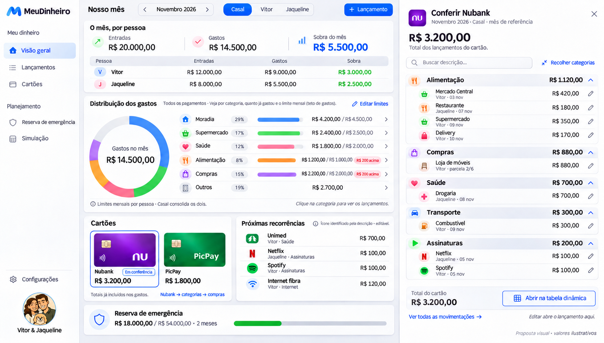

# Nosso mês — proposta de visão geral

Atualização aprovada em 11/11/2026: a reserva agora corresponde a todo o saldo acumulado com rendimento bruto a 100% do CDI, compartilhado com a Simulação. Editar meta define o objetivo em reais ou meses de despesas essenciais; o saldo de referência permanece em Configurações; a regra anterior de aportes separados descrita abaixo é histórica. Não somar movimentos manuais antigos ao acumulado.

11/11/2026. Mockup solicitado pelo usuário após nova referência; escopo refinado para reserva de emergência e limites opcionais por categoria. Proposta visual, sem alteração funcional do aplicativo.

Esta é a versão vigente. As imagens anteriores são referências históricas: [visão inicial](visao-geral.png) e [conferência anterior](categorias-e-cartoes.png). Seus cartões de viagem não fazem parte do escopo aprovado.

## Objetivo

Dar respostas e permitir ações de rotina na própria página inicial. Prioridade: entradas e gastos de Vitor/Jaqueline, compras no cartão para conferir/corrigir, organização por categoria e reserva de emergência. Reduzir a necessidade de alternar entre várias abas para tarefas básicas.

## Composição

### Refinamento — distribuição, limites e conferência de cartão

Limites de categoria são opcionais. A única finalidade de poupança desta proposta é a reserva de emergência; não haverá cartão de viagem nem menu genérico de metas.

O usuário quer preservar o fluxo atual do gráfico de distribuição: clicar numa categoria e ver a lista exata de lançamentos incluídos. O desenho complementar mostra distribuição mensal com limites e um cartão aberto no painel lateral. Ambos usam o mesmo padrão de conferência.

- Distribuição: rosca + categorias com ícone, participação, realizado e, quando houver limite mensal, limite e diferença. Clicar na fatia ou na linha abre a mesma lista incluída, com descrição, pessoa, data, parcela, valor e edição. O detalhamento deve explicar o conjunto de dados usado no total, mantendo reais e projeções distinguíveis.
- Limites de categoria são tetos mensais opcionais. Configuração por mês/pessoa/categoria e escopo temporal explícito para repetir ou ajustar. Sem limite, mostrar somente gasto e participação: sem “Definir limite”, denominador, barra de limite, alerta ou pendência. Acesso ao detalhamento continua normal. Configurar limites fica na ação global discreta Editar limites. Na visão Casal, comparar com um limite consolidado somente quando houver cobertura completa das duas pessoas; uma configuração parcial fica identificada no editor, sem apresentar teto completo enganoso. Ultrapassagem só aparece quando há limite aplicável. Essas regras são proposta, não modelo de dados já implementado.
- Cartão abre diretamente categoria → descrições → valores, com categorias inicialmente expandidas e ação Recolher categorias. Totais dos grupos e lançamentos devem fechar com o escopo do cartão. Editar fica no contexto; tabela dinâmica e lista completa continuam acessíveis. Pessoa e mês seguem selecionados. A imagem apresenta R$3.200,00: Alimentação1120 + Compras880 + Saúde700 + Transporte300 + Assinaturas200.
- Não usar o gasto parcial de um banco como realizado de um limite mensal que abrange todos os pagamentos. No desenho, limites aparecem na distribuição completa; o painel Nubank tem seu escopo próprio. Período de referência e fechamento de fatura continuam distintos.
- Dois níveis de ícone: categoria (Saúde, Alimentação etc.) e descrição reconhecida (serviço/estabelecimento). Resolver por associação manual, depois aliases normalizados conhecidos, depois ícone da categoria. Permitir corrigir associação. O ícone não muda categoria, pessoa, banco ou regras do lançamento. Netflix/Spotify/Unimed são exemplos visuais, não levantamento da base real do usuário.
- Usar catálogo local de ícones e marcas reconhecidas, com fallback; não enviar descrições financeiras para serviços externos só para buscar logotipo. Aplicar a mesma identificação em recorrências, tabelas, painel de detalhes e cadastro, sem depender só de cor.

A imagem complementar foi gerada pela ferramenta integrada com o mockup anterior e as duas novas referências. Prompt de direção: manter MeuDinheiro/Inter Tight/avatar, restaurar rosca clicável com metas mensais, ilustrar Nubank aberto em grupos de categorias com todas as descrições expandidas, marcas de serviços nas recorrências e edição contextual. Totais ilustrativos revisados; nenhum fluxo funcional foi alterado.

- O mês por pessoa: total consolidado e matriz com entradas, gastos e sobra de cada pessoa, sempre visíveis. Casal é filtro consolidado, nunca titular de um gasto. Filtro global por pessoa e mês.
- Cartões: Nubank e PicPay lado a lado, total por banco e por pessoa. Conferir compras filtra a lista já visível abaixo, sem página intermediária ou carrossel. Totais dos cartões já fazem parte dos gastos do mês.
- Gastos para conferir: busca, filtro de banco, categorias com valores e lançamentos com pessoa/categoria/cartão/valor. Editar abre contexto do lançamento; não exigir navegar para Cadastro primeiro. Preservar acesso à tabela completa, lote, parcelas, recorrências e tabela dinâmica. A lista parcial mostra subtotal próprio, sem confundir com o gasto total.
- Reserva: valor realmente separado, objetivo configurável e cobertura sobre despesas essenciais explicitamente definidas. Não inferir reserva a partir da sobra mensal ou do saldo projetado da Simulação. Cobertura ilustrativa: R$18.000 / R$9.000 mensais = 2 meses; meta ilustrativa de 6 meses = R$54.000. Não é recomendação financeira nem configuração real do usuário.
- Contas do início do mês: agrupamentos existentes, com situação e ações de organização. Também já incluídos no orçamento. Unimed em Saúde e categoria Internet preservadas.

## Regras para eventual implementação

1. Preservar cálculos ricos de Simulação, análises e tabela dinâmica como aprofundamentos; simplificar acesso sem remover capacidades.
2. Reserva exige registros reais de aportes/retiradas e titularidade por pessoa, mantendo filtro global coerente. Não atribuir automaticamente saldo consolidado a Vitor ou Jaqueline. As duas pessoas podem contribuir para uma mesma finalidade, sem criar uma terceira pessoa chamada Casal.
3. Mostrar explicitamente o escopo dos cartões: hoje a aplicação usa mês de referência. O texto Fatura do desenho representa intenção visual; não chamar a soma do mês de fatura bancária confirmada sem período/fechamento compatíveis. Conferência continua manual, sem alegar integração automática com banco.
4. Conferir com o banco é distinto de marcar conta paga. Possível estado de conferência precisa de contrato próprio; o desenho não altera dados existentes.
5. A página inicial prioriza a rotina, com menu reduzido. Categorias, recorrências, importação e operações avançadas seguem acessíveis, sem eliminar dados ou funções para caber no desenho.
6. Validar layout desktop e mobile, teclado e estados vazios/erro com dados reais ao implementar. Mockup não comprova acessibilidade ou funcionamento.

## Geração

Imagem criada com a ferramenta integrada de geração de imagens, usando a referência enviada em11/11 e o avatar familiar aprovado como fontes visuais. Prompt de direção: screenshot de MeuDinheiro em português, Inter Tight e painéis brancos com respiro, comparação individual de entradas/gastos/sobra, cartões por banco/pessoa, compras editáveis na mesma tela, reserva configurável, contas mensais, ícones coloridos e navegação curta. A revisão vigente remove viagem/metas de poupança e qualquer sugestão de definir limite nas categorias sem teto; expande a reserva no espaço disponível. Todos os valores são ilustrativos e foram revisados quanto à relação entre totais/subtotais e ausência de dupla contagem.

Implementação solicitada e integrada à Nova UI em 11/11/2026. Imagens seguem ilustrativas; o aplicativo usa seus dados e não cadastra os valores dos desenhos. Próxima função, somente planejada: [lista de desejos e projeção de compras](PLANO_DESEJOS.md).
