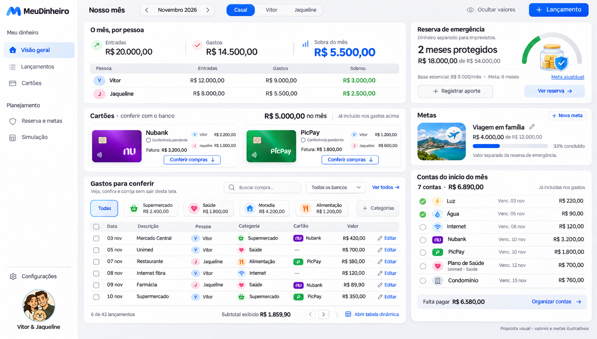

# Nosso mês — proposta de visão geral

11/11/2026. Mockup solicitado pelo usuário após nova referência com reserva de emergência e metas. Proposta visual, sem alteração funcional do aplicativo.

## Objetivo

Dar respostas e permitir ações de rotina na própria página inicial. Prioridade: entradas e gastos de Vitor/Jaqueline, compras no cartão para conferir/corrigir, organização por categoria, reserva e metas. Reduzir a necessidade de alternar entre várias abas para tarefas básicas.

## Composição

- O mês por pessoa: total consolidado e matriz com entradas, gastos e sobra de cada pessoa, sempre visíveis. Casal é filtro consolidado, nunca titular de um gasto. Filtro global por pessoa e mês.
- Cartões: Nubank e PicPay lado a lado, total por banco e por pessoa. Conferir compras filtra a lista já visível abaixo, sem página intermediária ou carrossel. Totais dos cartões já fazem parte dos gastos do mês.
- Gastos para conferir: busca, filtro de banco, categorias com valores e lançamentos com pessoa/categoria/cartão/valor. Editar abre contexto do lançamento; não exigir navegar para Cadastro primeiro. Preservar acesso à tabela completa, lote, parcelas, recorrências e tabela dinâmica. A lista parcial mostra subtotal próprio, sem confundir com o gasto total.
- Reserva: valor realmente separado, objetivo configurável e cobertura sobre despesas essenciais explicitamente definidas. Não inferir reserva a partir da sobra mensal ou do saldo projetado da Simulação. Cobertura ilustrativa: R$18.000 / R$9.000 mensais = 2 meses; meta ilustrativa de 6 meses = R$54.000. Não é recomendação financeira nem configuração real do usuário.
- Metas: nome, valor separado, objetivo e progresso. Meta da viagem usa R$4.000 de R$12.000 e não reutiliza os R$18.000 da reserva. Nenhuma previsão de conclusão inventada.
- Contas do início do mês: agrupamentos existentes, com situação e ações de organização. Também já incluídos no orçamento. Unimed em Saúde e categoria Internet preservadas.

## Regras para eventual implementação

1. Preservar cálculos ricos de Simulação, análises e tabela dinâmica como aprofundamentos; simplificar acesso sem remover capacidades.
2. Reserva/metas exigem registros reais de aportes/retiradas e titularidade por pessoa, mantendo filtro global coerente. Não atribuir automaticamente saldo consolidado a Vitor ou Jaqueline. As duas pessoas podem contribuir para uma mesma finalidade, sem criar uma terceira pessoa chamada Casal.
3. Mostrar explicitamente o escopo dos cartões: hoje a aplicação usa mês de referência. O texto Fatura do desenho representa intenção visual; não chamar a soma do mês de fatura bancária confirmada sem período/fechamento compatíveis. Conferência continua manual, sem alegar integração automática com banco.
4. Conferir com o banco é distinto de marcar conta paga. Possível estado de conferência precisa de contrato próprio; o desenho não altera dados existentes.
5. A página inicial prioriza a rotina, com menu reduzido. Categorias, recorrências, importação e operações avançadas seguem acessíveis, sem eliminar dados ou funções para caber no desenho.
6. Validar layout desktop e mobile, teclado e estados vazios/erro com dados reais ao implementar. Mockup não comprova acessibilidade ou funcionamento.

## Geração

Imagem criada com a ferramenta integrada de geração de imagens, usando a referência enviada em11/11 e o avatar familiar aprovado como fontes visuais. Prompt de direção: screenshot de MeuDinheiro em português, Inter Tight e painéis brancos com respiro, comparação individual de entradas/gastos/sobra, cartões por banco/pessoa, compras editáveis na mesma tela, reserva configurável, meta separada, contas mensais, ícones coloridos e navegação curta. Todos os valores são ilustrativos e foram revisados quanto à relação entre totais/subtotais e ausência de dupla contagem.

Próximo passo: usuário avaliar esta organização da rotina antes de nova implementação.
