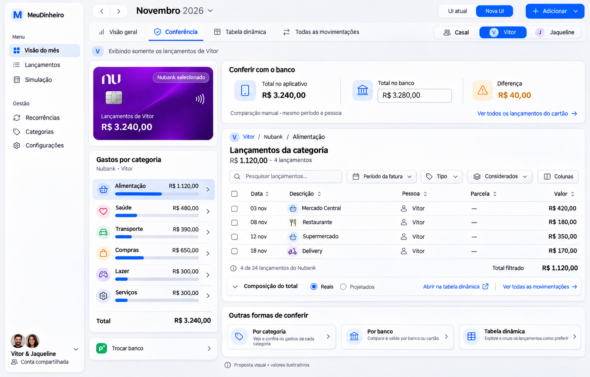
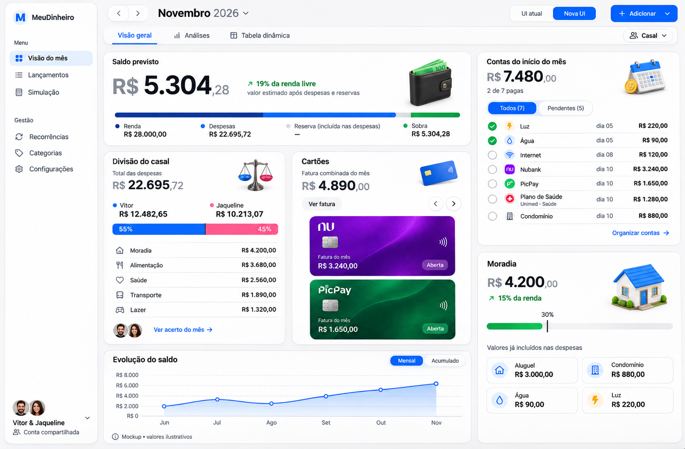
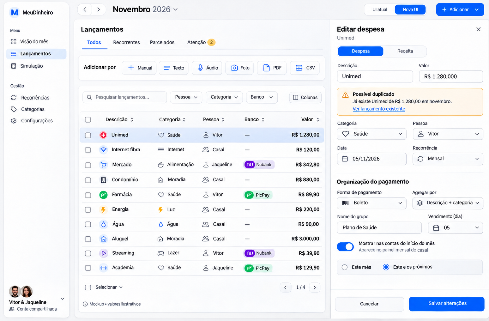
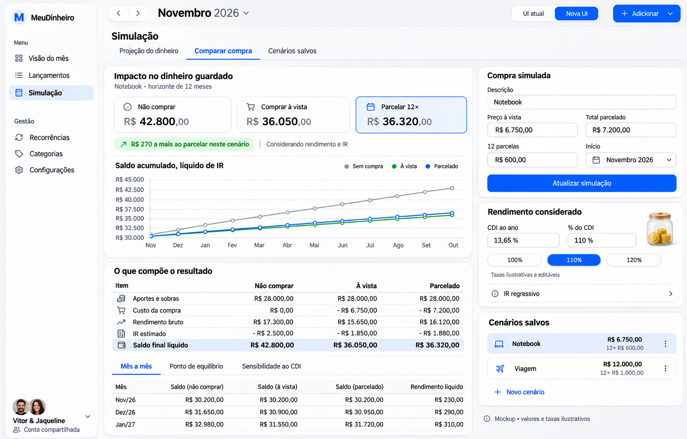

# MeuDinheiro — proposta de reconstrução da Nova UI

10/11/2026. Proposta visual; ainda não implementada. Imagens geradas com a ferramenta integrada de geração de imagens. Valores, taxas, avatares e gráficos são ilustrativos; textos e números das imagens não constituem contratos de implementação.

## Direção

Reconstruir a experiência moderna com composição própria, em vez de acrescentar painéis à página clássica e sobrescrever estilos globalmente. Preservar o toggle e compartilhar os serviços, cálculos, validações e permissões existentes entre as duas apresentações.

- Referência principal: print enviado pelo usuário. Painéis brancos compactos, fundo cinza suave, barra lateral estreita, tipografia Inter Tight, hierarquia numérica e cartões físicos bem renderizados.
- Base proposta: corpo 12–13px, títulos de painel 14–16px, título de página 18px, saldo principal 36–40px; moeda e centavos menores. Ajustar legibilidade na aplicação real.
- Espaçamento de 4px, intervalos de 12–16px entre painéis, raio de 12px, bordas suaves; azul nas ações, cores dos bancos nos cartões e cores semânticas consistentes.
- Ilustrações pequenas com o mesmo material, iluminação e escala; gerar recursos próprios para implementação. Cartões com textura, chip e símbolo de aproximação, sem inventar número, limite ou vencimento.
- Estados de carregamento, vazio, erro, foco e salvamento fazem parte dos componentes. Contraste, navegação por teclado e alvos de toque precisam de validação real; as imagens não validam acessibilidade.

## Telas

### Titularidade e filtro de pessoa — regra transversal

Cada gasto pertence exclusivamente a Vitor ou Jaqueline. Casal é apenas a visão que consolida os dois, nunca uma pessoa selecionável no cadastro. O filtro Casal / Vitor / Jaqueline deve atualizar todos os totais, cartões, categorias, pagamentos, gráficos e movimentações do contexto. A simulação parte igualmente da base correspondente à pessoa selecionada. Preservar essa seleção ao navegar para o detalhamento e voltar. Comparações entre pessoas só aparecem na visão Casal; na visão individual não expor gastos da outra pessoa.

Os mockups iniciais são superados por esta regra: as linhas com Pessoa = Casal no desenho de Lançamentos devem ter Vitor ou Jaqueline. A seção de divisão passa a representar participação de cada pessoa nas despesas consolidadas, sem sugerir gastos compartilhados, rateio ou acerto financeiro entre elas. Não implementar o link de acerto do primeiro desenho.

### Conferência por categoria e banco

Entrada pelo total de uma categoria ou por um cartão, preservando mês e pessoa. Banco e categoria são filtros independentes: conferir qualquer categoria com todos os bancos ou as categorias de um banco específico. Mostrar total por categoria e abrir as movimentações que compõem exatamente esse total; exibir pessoa, banco, data, categoria, parcela e valor, mantendo colunas adicionais acessíveis. Voltar não deve perder o contexto.

Manter Tabela dinâmica e Todas as movimentações como caminhos diretos, com seus recursos existentes. Os links de detalhamento e retorno precisam transportar os filtros compatíveis. Valores da categoria, subtotal dos lançamentos e total do banco devem usar o mesmo conjunto de dados e explicitar quais filtros se aplicam a cada um.

Sugestão adicional: comparação manual opcional com o total informado pelo usuário no aplicativo do banco, mostrando diferença. Não é sincronização bancária nem correção automática de despesas. O escopo da comparação deve ser explícito (pessoa, banco, período e regras da fatura); não tratar mês de referência como período de fechamento automaticamente. Reais e projetados precisam ser distinguíveis; usar apenas reais na conferência bancária por padrão, sem alterar a regra das projeções na visão mensal. O total informado do banco deve permanecer associado ao seu escopo ou ser limpo ao trocar filtros; não comparar um total de fatura completa com apenas uma categoria. A diferença não implica que falta necessariamente uma compra: parcelas, estornos, encargos e período podem divergir.

Ícones fazem parte da linguagem do produto: categorias com símbolos e cores consistentes, Nubank roxo, PicPay verde e pessoa identificada por nome/avatar. Reutilizar o mesmo ícone de categoria em resumos, filtros, tabelas e editores. Não depender apenas de cor ou ícone para transmitir significado, nem criar ícones decorativos diferentes para a mesma categoria. Ícones de estabelecimentos no mockup são ilustrativos; a implementação pode usar o ícone da categoria sem inferir estabelecimento automaticamente.

O mockup de conferência foi gerado pela ferramenta integrada usando os dois primeiros desenhos como referência, com prompt para filtro global Vitor, cartão Nubank, categorias com ícones, detalhamento de Alimentação e comparação manual de totais. Valores ilustrativos.

### Visão do mês

Saldo e composição no topo, divisão do casal e cartões no centro, contas do início do mês e moradia à direita. Abas Visão geral / Análises / Tabela dinâmica, mantendo todos os indicadores, filtros e bookmarks existentes. As análises não serão duplicadas abaixo de um novo painel.

O painel de contas reutiliza os agrupamentos existentes. Plano de Saúde reconhece Unimed em Saúde, Internet corresponde à categoria Internet. Faturas mantêm prioridade para impedir dupla contagem. Pagamento e organização continuam com as regras atuais. Participação por pessoa não representa rateio nem gera acerto entre pessoas. O filtro individual também se aplica integralmente a esse painel.

### Lançamentos

Tabela como área principal, ações de captura compactas e editor lateral com contexto visível. Preservar filtros, 14 colunas acessíveis, ordenação, paginação, seleção e edição em lote, importação e tratamento de recorrências/parcelas. Alerta de duplicidade junto do preenchimento, sem alertar sobre o próprio registro editado; continuar disponível nas duas UIs.

Organização de pagamentos no editor: forma, agregação, grupo, vencimento e participação no início do mês. Mapear as opções visuais para as capacidades existentes; qualquer ampliação de contrato exige validação específica.

### Simulação

Projeção do dinheiro / Comparar compra / Cenários salvos. Comparação entre não comprar, comprar à vista e parcelar em destaque, com saldo líquido e gráfico. Manter rendimento bruto e líquido, IR regressivo, sobras/aportes, evolução mensal, ponto de equilíbrio, sensibilidade ao CDI, múltiplos cenários, edição, arquivamento e insights existentes. Os resultados devem vir dos cálculos atuais, sem fórmulas novas baseadas no desenho.

### Demais áreas e mobile

Recorrências, Categorias, Configurações, importação e Atenção reutilizam a mesma barra de ferramentas, tabela, campos, painel lateral e mensagens. Não há mockups específicos dessas áreas nesta proposta. No mobile, reorganizar prioridades em uma coluna, navegação acessível, cartões navegáveis e editor em tela cheia; tabelas conservam acesso a todas as colunas e ações. Criar e validar layouts mobile na implementação.

## Execução proposta

1. Componentes de apresentação modernos e estrutura de navegação isolados; preservar escolha de interface.
2. Visão mensal completa e ativos visuais de qualidade, com dados reais e sem repetição das análises.
3. Lançamentos, editores e fluxos de captura/atenção no mesmo padrão.
4. Simulação e demais áreas, preservando contratos financeiros e operações existentes.
5. Validar telas completas desktop/mobile, teclado, carregamento/erros, regressões financeiras, lint e build antes da publicação funcional.

Prompt utilizado nas três gerações: screenshot de aplicação financeira MeuDinheiro em português, inspirado na composição compacta do print, Inter Tight, painéis brancos em fundo cinza, navegação estreita e toggle; variantes Visão do mês com cartões Nubank/PicPay realistas e contas agregadas, Lançamentos com editor lateral e alerta de duplicidade, Simulação com comparações e detalhamento de rendimento/IR. Cada geração especificou as seções e a hierarquia acima. Método: geração integrada, sem CLI externa.
